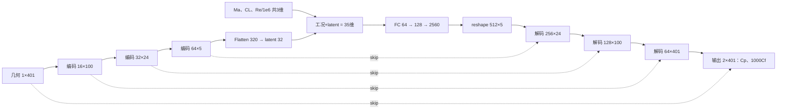

# 二维翼型神经网络结构与论文训练设置核对

模型与训练入口、可调参数、核心代码导航及权重加载方法统一见
[二维神经网络使用说明](二维神经网络使用说明.md)。本文保留详细逐层结构和论文对照。

## 本轮实际训练与权重

已经按用户“每条选中训练数据只训练一遍”的要求完成联合二维训练。
权重为 [weights/2d/latest.pt](weights/2d/latest.pt)，训练入口为
[train_2d_once.py](train_2d_once.py)。它复用下文检查的 AirfoilPredictor，
没有改动网络结构，也没有训练 SLD 或三维网络。

| 数据子集 | 本地全部记录 | 本轮训练记录 | 本轮验证记录 |
|---|---:|---:|---:|
| VT-BUF | 25,607 | 14,498 | 1,503 |
| VT-DD | 17,386 | 9,936 | 1,051 |
| VT-GU | 16,031 | 9,240 | 1,038 |
| 合计 | 59,024 | **33,674** | **3,592** |

完整扫描确认三组 data/index 均为真实数值数组且没有 NaN/Inf，FT 缺少表面场 data.npy，
未用于训练。所有 VT 使用全局基准翼型 Running_ID 分组，先保护三个子集官方测试家族的并集
（502 个家族），余下 918 个家族再以 seed=42 划分为 826 个训练家族、92 个验证家族。
因此 21,758 条记录留在保护集合中，没有用于优化器或归一化范围拟合。
GU 对同一基准翼型的厚度变体也归入同一家族，避免跨子集泄漏。

按原始文件记录各使用一次，保留 BUF/DD 间的近重复记录，不将它们错误地视为独立的几何身份。
完整数据库中有 1,190 对近重复输入，其中有一对目标略有差异，未机械地按近似输入键去重。
VT-GU 对应论文数据来源，BUF/DD 属于本轮纳入的额外工况扩展。

| 实际训练项 | 结果 |
|---|---|
| 环境 | Conda flogen，PyTorch 2.15.0+cu132，RTX 3060 |
| 训练次数 | 单次初始化、1 epoch，每条选中训练记录恰好一次 |
| 优化器和损失 | Adam、训练集 min/max 空间 MSE |
| batch size | 16，保留最后一个 10 条记录的小批次 |
| 学习率 | 1e-5，即论文 20 轮预热的第一轮；没有压缩整个调度到一轮 |
| 优化步数 | 2,105 |
| 训练 MSE | 0.02616506098，整个 epoch 的累计平均，包含训练初期误差 |
| 验证归一化 MSE | 0.004423599793，最后一步模型在独立验证集上的结果 |
| 验证 Cp RMSE | 0.2759922364 |
| 验证 1000×Cf RMSE | 0.8638330342，对应实际 Cf RMSE 0.0008638330342 |
| 最新模型保存 | 最后优化步参数及训练归一化 buffer，不回退到历史最佳参数 |
| 权重保留 | weights/2d 中仅一份 latest.pt，无旧权重或临时权重残留 |

已经使用现有 `main.load_checkpoint(..., "airfoil")` 重新加载，所有参数和 buffer 有限，
对一条真实验证样本得到有限的 `(1,2,401)` 输出。已核对训练、验证、保护测试家族互不重叠，
并由逐行访问计数确认全部 33,674 条记录恰好使用一次。

训练记录为 [training_report.json](weights/2d/training_report.json)，
状态和读回检查分别为 [status.json](weights/2d/status.json) 与
[verification.json](weights/2d/verification.json)，进度日志为
[train.log](weights/2d/train.log)。新增训练器的三项临时合成回归测试全部通过，
涵盖全局划分、最后小批次、最新权重替换与旧文件保护。

本轮保存的是权重和归一化/训练元信息，不包含 Adam 状态；没有承诺从中断处逐步精确恢复优化。
这次单轮结果不是论文 300 轮、五次初始化后选优的精度复现；数据只覆盖已确认 Re=2e7，
不能据此声称模型已经学会跨 Re 变化。

读取权重示例（输入工况第三项仍是 Re/1e6）：

```python
from main import load_checkpoint

model, spec, checkpoint = load_checkpoint("weights/2d/latest.pt", "airfoil")
model.eval()
# geometry: (B,1,401) 原始 y/c；conditions: (B,3) [Mach,CL,Re/1e6]
# prediction = model(geometry, conditions)  # (B,2,401)，Cp、1000×Cf
```

以下结构检查针对当前实际运行的 `main.py → AirfoilPredictor(ModelSpec(condition_dim=3))`，使用 Conda `flogen` 的 Python 3.12，通过 `named_modules()`、模型打印和 CPU 前向钩子核对各层类型、输入输出尺寸与参数数目。结构核查本身只做前向计算；随后完成的真实单轮训练及权重记录见上节。

## 入口和模型性质

二维模型类位于 [main.py](main.py)，调用原作者仓库的 `flowvae.base_model.conv.convEncoder_Unet`、`convDecoder_Unet` 以及 `flowvae.vae.Unet`。当前主入口的二维训练命令为 `pretrain-2d`，与 SLD 和三维残差网络训练分开。

这是一个**确定性的条件一维卷积 U-Net**。虽然历史类名和中间层沿用 `vae`、`fc_mu` 等命名，当前这个模型没有随机采样、方差分支或 KL 损失；它根据翼型几何与工况直接预测两条表面系数分布。二维模型不需要输入 SLD 或三维表面网格。

| 项目 | 实际内容 |
|---|---|
| 几何输入 | `(B,1,401)`，401 个翼型轮廓位置的 y/c |
| 工况输入 | `(B,3)`，按 Mach、CL、Re/1e6 的顺序 |
| 输出 | `(B,2,401)`，通道 0 为 Cp，通道 1 为 SuperFoil 原存储单位的 `1000×Cf` |
| 可训练参数 | **940,424** |
| 归一化缓冲量 | 12 个标量，即几何 1、工况 3、输出 2 个变量各自的 minimum/scale |
| 激活函数 | 隐藏层 LeakyReLU，negative_slope=0.01 |
| BatchNorm / Dropout | 当前二维构造均未启用 |
| 最后输出层 | 线性卷积输出，无 Sigmoid、Tanh 或 ReLU 限幅 |

B 是批大小，正式训练默认取论文设置 16。这里保留批次维度，单个样本也是 `(1,1,401)`、`(1,3)` 和 `(1,2,401)`。

## 实测逐层结构

以下所有尺寸都省略共同的批次维 B，并按“通道×周向点数”表示卷积特征。Conv1d 的 k/s/p 分别表示核大小、步长和填充。每组编码器的顺序是卷积、LeakyReLU、平均池化。

| 阶段 | 实际操作 | 输入尺寸 | 输出尺寸 | 可训练参数 |
|---|---|---|---|---:|
| 几何归一化 | 训练集逐变量 min/max | 1×401 | 1×401 | 0 |
| 编码块 1 卷积 | Conv1d 1→16，k=3,s=2,p=1；LeakyReLU | 1×401 | 16×201 | 64 |
| 编码块 1 池化 | AvgPool1d k=3,s=2,p=0 | 16×201 | **16×100** | 0 |
| 编码块 2 卷积 | Conv1d 16→32，k=3,s=2,p=1；LeakyReLU | 16×100 | 32×50 | 1,568 |
| 编码块 2 池化 | AvgPool1d k=3,s=2,p=0 | 32×50 | **32×24** | 0 |
| 编码块 3 卷积 | Conv1d 32→64，k=3,s=2,p=1；LeakyReLU | 32×24 | 64×12 | 6,208 |
| 编码块 3 池化 | AvgPool1d k=3,s=2,p=0 | 64×12 | **64×5** | 0 |
| 几何潜变量 | Flatten；Linear 320→32，无额外激活 | 64×5 | **32** | 10,272 |
| 工况归一化与拼接 | 归一化工况 3 维与几何潜变量 32 维拼接 | 3＋32 | **35** | 0 |
| 解码连接层 1 | Linear 35→64；LeakyReLU | 35 | 64 | 2,304 |
| 解码连接层 2 | Linear 64→128；LeakyReLU | 64 | 128 | 8,320 |
| 解码初始特征投影 | Linear 128→2560；LeakyReLU；reshape | 128 | **512×5** | 330,240 |
| 解码块 1 | 拼接 64×5 编码特征；线性插值到 24；Conv1d 576→256，k=3,s=1,p=1；LeakyReLU | (512＋64)×5 | **256×24** | 442,624 |
| 解码块 2 | 拼接 32×24 编码特征；线性插值到 100；Conv1d 288→128，k=3,s=1,p=1；LeakyReLU | (256＋32)×24 | **128×100** | 110,720 |
| 解码块 3 | 拼接 16×100 编码特征；线性插值到 401；Conv1d 144→64，k=3,s=1,p=1；LeakyReLU | (128＋16)×100 | **64×401** | 27,712 |
| 最后输出卷积 | 拼接原几何 1×401；Conv1d 65→2，k=3,s=1,p=1 | (64＋1)×401 | **2×401** | 392 |
| 逆归一化 | 两个输出变量分别恢复原存储单位 | 2×401 | 2×401 | 0 |

参数分组核对：编码卷积共 7,840，几何潜变量投影 10,272，解码全连接共 340,864，解码卷积共 581,448，总计 940,424。

跳跃连接在上采样前进行拼接：三个低分辨率编码特征 64×5、32×24、16×100 分别连接对应解码块；输出层前还连接原始归一化几何。插值使用 PyTorch 的 `linear` 模式、`align_corners=False`，其后接普通卷积，不是转置卷积。工况的实际拼接顺序是 `[归一化Ma,归一化CL,归一化Re/1e6,32维几何潜变量]`。



## 与物理嵌入论文的对应关系

依据项目内 `2025_AIAAJ_基于物理嵌入式迁移学习的后掠翼快速气动预测.md` 第 II.B.1、III.D、IV.A 及附录 A1。

| 项目 | 论文设置 | 当前结构或本轮要求 |
|---|---|---|
| 模型框架 | 条件一维卷积 U-Net，输入几何及三项工况 | 一致 |
| 编码通道 | 16、32、64 | 一致 |
| 几何潜变量 | 32 维 | 一致 |
| 解码通道 | 初始 512，随后 256、128、64，最后两通道 | 一致 |
| 解码全连接 | 隐藏维度 64、128，连接初始特征图 | 一致，最后投影为本数据所需的 512×5 |
| 翼型点数 | 321，编码长度 80→19→4 | 适配现有 SuperFoil 的 **401**，长度 100→24→5，输出仍与原数据点一一对应 |
| 变量归一化 | 各变量 min/max | 当前模型保存训练集拟合的 minimum/scale，验证和测试不参与拟合 |
| 优化器和损失 | Adam、MSE | 保持该方法，损失在逐变量归一化空间计算 |
| 批大小 | 16 | 保持 16 |
| 学习率 | 前 20 轮从 1e-5 预热到 1e-4，随后每轮按 0.95 衰减 | 一遍训练只运行第 1 轮，因此使用预热首轮 **1e-5**；不会将后续轮次调度压缩成一遍 |
| 训练时长 | 300 轮；5 次不同初始化，选择表现最好的模型 | 用户本轮要求数据仅训练一遍，因此 **1 个 epoch、单次初始化**，不执行 300 轮或五次训练 |
| 输出权重选择 | 多轮/多次训练中选误差最小模型 | 用户要求保留当前最新权重，应保存最后一次实际参数状态，不回滚到更早状态 |

一个 epoch 指本轮选用的全部训练样本各用于一次优化，不是仅一个 batch 或一个优化步；训练保留的验证/测试样本只做评估，不用于参数更新。原生 `main.py fit_model()` 会在结束时恢复最佳验证状态，本轮训练入口若组合多个子集或持续保存最新权重，应显式遵循用户“最新权重”语义，不能把某个早期最佳状态称作最终一步。

## 数据接口与适用边界

`SuperFoilData` 直接读取 VT 子目录下的原始 `data.npy` 与 `index.npy`，几何取 `data[:,0:1,:]`，输出标签取 `data[:,1:3,:]`，原始三通道为 y/c、Cp、1000×Cf。不会将三维的 150×Cf_tau、300×Cf_z 倍率套到二维数据。

VT-BUF 与 VT-GU 的 Mach/CL 使用 index 的零基列 5/9，VT-DD 则使用零基列 3/6；DD 的第 9 列是实际攻角，不能当作 CL。源文件不直接提供逐样本 Re 列，当前已确认配置为实际 Re=2e7，网络输入单位为百万，第三项即 20。该通道在训练集 min/max 中是常量，归一化后为零；**保留 Re 输入并不代表这些固定 Re 数据能教会模型对不同 Re 的响应**，后续若需要这种泛化应另有跨 Re 样本。

结构前向检查输出形状为 `(1,2,401)` 且符合预期。以上检查说明该网络可接受现有 VT 格式；真实样本总量、有限值、官方划分及跨子集重复/泄漏核查，由本轮单独的数据审计报告给出。一次遍历仅是用户指定的初步训练规模，不能据此宣称达到论文 300 轮模型的误差水平。
