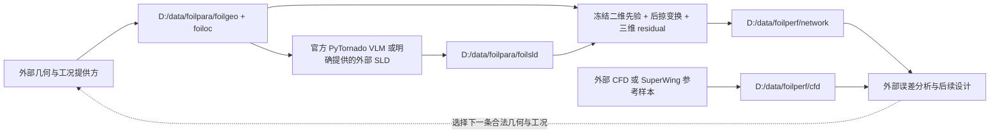

# 当前项目任务与外部多智能体协作接口

本仓库负责物理嵌入式神经网络、低保真展向升力估计和文件数据接口：从已准备好的机翼几何、工况与 SLD 预测机翼表面的压力及摩擦系数分布，并提供二维和三维独立训练流程。外部多智能体系统负责分析误差、选择新几何和组织后续 CFD/训练任务；本仓库没有实现 A–E 智能体的提示词、LLM 调度、几何设计优化器或新的 CFD 求解器。

`readforagent` 原文保留不变。本文按之后用户确定的接口和训练要求说明当前任务，实际行为以代码、数据契约及当前任务配置为准。

## 当前仓库交付

| 功能 | 当前实现 |
|---|---|
| 二维翼型预测 | `main.AirfoilPredictor`；输入 401 点 y/c 与 Mach、CL、Re/1e6；输出 Cp、1000×Cf |
| 二维训练 | SuperFoil 三个 VT 子集、固定 9∶1 train/test；已保存 60 轮权重 |
| 低保真 SLD | 官方 PyTornado 几何驱动 VLM，输出后掠变换前的 128 个截面 CL |
| 三维表面预测 | 冻结二维网络，经后掠理论生成先验，加三维 residual 修正，输出 Cp、150×Cf_tau、300×Cf_z |
| 三维训练 | 当前任务从零初始化 residual，以 batch size 8 训练 200 轮；二维保持冻结 |
| 评估与保留 | 每轮完整 test、记录 loss/百分比误差并画图；每 10 轮保存且校验后同步检查点到本机 |
| 文件交付 | `foilpara` 三目录输入、`foilperf/network` 网络输出及 `foilperf/cfd` 对照真值 |
| 兼容接口 | 保留 `bridge.py` 的旧增量训练/独立几何协议，其 FNN-SLD 前序要求与当前 VLM 权重不同 |

当前任务配置为 [build/superwing_200_bs8_config.json](build/superwing_200_bs8_config.json)，运行状态为 [weights/3d/server_200_bs8_job.json](weights/3d/server_200_bs8_job.json)。目标 200 轮不表示已经完成 200 轮，完成情况应读取实时状态和最终 verification。

## 正式数据流

正式推理入口为 `python -B main.py predict-foilpara --checkpoint <已训练三维权重>`。当前只处理一个机翼与一个工况：几何配置 `(1,41)`、中心 `(1,3,128,256)`、顶点 `(1,3,129,257)`；工况索引 `(1,6)`、实际 Re `(1,)`；SLD `(1,128)`。输出为 float32 的 `(1,3,128,256)`，分别存储 Cp、150×Cf_tau、300×Cf_z。这里输出的是无量纲表面系数；需要表面力或整翼升阻力时须按相应几何与物理定义另行积分。

输入根目录为 `D:/data/foilpara`，其子目录 `foilgeo`、`foiloc`、`foilsld` 必须按各自 `format.md` 提供配套数据。几何参数须与真实表面网格一并交付；本仓库不会只根据 CST/平面参数自动生成完整 CAD 或 CFD 体网格。

网络结果位于 `D:/data/foilperf/network`，参考真值位于 `D:/data/foilperf/cfd`。使用 `superwing_io.py export` 可从数据库选取一条 case，交付参考输入/CFD；没有明确传入已训练检查点时不会伪造网络结果。读取和来源字段见 [SUPERWING_IO.md](SUPERWING_IO.md)，正式形状、索引、倍率和目录冲突约束见 [FOILPARA.md](FOILPARA.md)。

## 外部 A–E 系统的职责边界

原总体设计希望使用 DSPy 组织五个智能体，并以 `deepseek-flash` 作为外部语言模型选项。这是外部系统设计意图，不是本仓库已经配置好的 LLM 服务或正在执行的智能体流程。

| 外部角色 | 总体设计职责 | 与本仓库的关系 |
|---|---|---|
| A | 比较神经网络与 CFD，定位差异较大的区域 | 消费网络/CFD 的同 case 文件和来源信息 |
| B | 根据误差分析可能缺失的物理机制及其强度 | 使用外部分析结果；本仓库不生成物理机制标签 |
| C | 分析哪些几何容易触发这些机制 | 外部数据库与设计分析 |
| D | 在合法范围内提出新翼形 | 交付合法几何、工况和配套网格，不能仅交任意参数 JSON 代替正式输入 |
| E | 检查设计、协调 CFD/训练、反馈效果 | 外部调度；不能把当前固定 200 轮任务描述为已经实现动态训练策略 |

当前 VLM 三维权重要求外部 SLD，不使用未训练的内部 FNN。保留的旧 `bridge.py` 可以表达兼容 FNN-SLD 检查点的增量任务和训练反馈，但不能直接接续当前 VLM 权重。其独立 geometry manifest 与 `foilpara` 单算例布局也不能混用，详见 [BRIDGE.md](BRIDGE.md)。

## 算法、训练和文件保护范围

官方 VLM、FNN 直接预测 SLD、FNN 预测 CFD−VLM 残差再加 VLM 三种作者方案均保留；当前正式训练仅使用纯 VLM，另外两条代码不代表已有对应的训练权重。完整来源和当前训练行为见 [IMPLEMENTATION.md](IMPLEMENTATION.md)、[PYTORNADO.md](PYTORNADO.md)。

二维权重位于 `weights/2d/latest.pt`，当前三维任务的独立检查点位于 `weights/3d/superwing_200_bs8_20261111_190048/checkpoints/`。服务器通过本机 PyCharm subprocess/SSH 启动，使用 Conda `flogen`；所有服务器任务文件、数据、缓存和输出均在 `/home/cvlab/Projects/floGen`。清理或整理文档不能中断运行中的训练或移动其配置、缓存、主机密钥与必要依赖。

项目目录与保留原因见 [docs/PROJECT_STRUCTURE.md](docs/PROJECT_STRUCTURE.md)。方法来源为项目内[论文译文](2025_AIAAJ_基于物理嵌入式迁移学习的后掠翼快速气动预测.md)；论文原稿完整保留，但其引用的 `assets/2025_AIAAJ_PE_fig*.png` 插图原本未随项目提供。这些缺失插图不属于训练或推理运行依赖。
